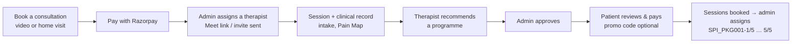
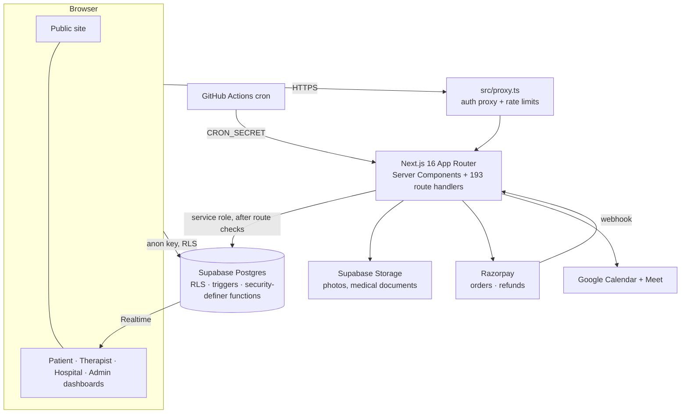

<div align="center">


# MoveRestore Physiotherapy

**Physiotherapy that comes to you - by video or at your door.**

[](https://github.com/nitheesh-git-project/Claude/actions/workflows/quality-gate.yml)
[](https://github.com/nitheesh-git-project/Claude/actions/workflows/ci.yml)
[](https://nextjs.org)
[](https://react.dev)
[](https://www.typescriptlang.org)
[](https://tailwindcss.com)
[](https://supabase.com)
[](https://razorpay.com)
[](https://developers.google.com/calendar)
[](https://playwright.dev)
[](https://vitest.dev)

[Quick start](#quick-start) · [Features](#features) · [Architecture](#architecture) · [Tech stack](#tech-stack) · [Environment](#environment-variables) · [Testing](#testing--quality-gate) · [Product guide](docs/PRODUCT-GUIDE.md)

</div>

```bash
npm install
cp .env.example .env.local   # fill in the values below
npm run dev                  # http://localhost:3000
```

> Production web app for a physiotherapy practice: public marketing site, patient booking and Razorpay payments across two delivery modes (video consultation and in-home visit), therapist scheduling and payouts, recommended treatment programmes, hospital (B2B) referrals, and a full admin back office.

* * *

## Contents

**Get started** · [Why MoveRestore](#why-moverestore) · [Features](#features) · [Quick start](#quick-start) · [Environment variables](#environment-variables) · [Scripts](#scripts)

**How it works** · [Roles](#roles) · [A patient's journey](#a-patients-journey) · [Architecture](#architecture) · [Tech stack](#tech-stack) · [Data model](#data-model) · [Project layout](#project-layout)

**Operate & contribute** · [Testing & quality gate](#testing--quality-gate) · [Security model](#security-model) · [Branches & deployment](#branches--deployment) · [Documentation map](#documentation-map) · [Roadmap](#roadmap)

* * *

## Why MoveRestore

Recovery is won by turning up. MoveRestore keeps a patient with **the same physiotherapist** from the first assessment to the last session, wherever the session happens - a video call or a visit to their home. Every booking, payment, clinical note and payout lives in one place, priced and timed by rules the clinic controls from its own dashboard rather than hard-coded in the app.

* * *

## Features

| Area | What it does |
| --- | --- |
| **Public site** | Conditions catalogue with photographs, how it works, home visits, team profiles (rich-text bios), mission & vision, FAQ, testimonials, opening splash, country-aware pricing |
| **Booking** | Three-step wizard (service → date & time → details & pay), General Consultation preselected, 12-hour lead time, clinic-zone times, resume an unpaid booking at checkout, promo codes |
| **Home visits** | Pincode service areas with a per-visit travel fee, one clinic-wide home-visit price with per-condition overrides, cash at the door or prepaid |
| **Payments** | Razorpay orders, signature verification, webhook fulfilment, refunds with Razorpay's own reason quoted, pay later, a single capture funnel so a payment seen twice is recorded once |
| **Recommended programmes** | Therapist recommends N sessions → admin approves → patient reviews & pays (with promo codes valid on programmes) → sessions booked and assigned through the admin → progress tracked as `SPI_PKG001-2/5` |
| **Sessions** | Session IDs (`SS1040`), Google Meet links for video, calendar invites with the address for home visits, therapist suggestions, completion and no-show, session notes, feedback both ways |
| **Clinical record** | Health profile per specialty (ortho, neuro, paeds), therapist-led intake, interactive Pain Map, care plans, medical documents, pain-trend charts |
| **Patient dashboard** | Home feed, suggested programmes, sessions (upcoming / past), programmes, payments, health profile, profile; animated first-visit tutorial with (i) help on every page |
| **Therapist dashboard** | Today's sessions, weekly roster with exceptions and time off, patients' charts, onboarding guide, recommendations, earnings and payout requests |
| **Hospital dashboard** | Refer patients, track referral status, earn a configured revenue share |
| **Admin back office** | Today (inbox + recommendation pulse), Sessions (schedule, all sessions, roster, delivery), Programmes (pipeline, list, timeline drawer), People, Money (summary, business health, transactions, payouts, owed, costs), Catalog (conditions, home-visit prices, service areas, countries), Logs (everyone's actions), Settings, System Health |
| **Access control** | Scoped admin desks (Master, Operations, Clinical, Finance), impersonation with an exit banner, approval and decline (with reasons) for new accounts |
| **Operations** | Scheduled maintenance sweep, rate limiting, risk signals, realtime dashboards, CSV/PDF exports, debug clock and data reset for pre-launch testing |

* * *

## Quick start

**Requirements:** Node.js 20+, a Supabase project, Razorpay **test** keys, and (optionally) Google Calendar OAuth credentials for Meet links.

```bash
npm install
cp .env.example .env.local      # fill in the table below
node scripts/run-schema.mjs     # apply supabase/schema.sql (needs SUPABASE_ACCESS_TOKEN) - run it twice
npm run seed:qa                 # optional: QA patient, therapist, hospital and admin accounts
npm run dev
```

> [!IMPORTANT]
> `supabase/schema.sql` is the single source of truth and is **re-runnable**. Apply it twice after every change; the second run proves it is still idempotent.

> [!NOTE]
> An admin is promoted by hand (set `profiles.role = 'admin'` in the Supabase Table Editor). Patients and therapists sign up from the site and are approved from the dashboard; hospitals are provisioned by an admin.

* * *

## Environment variables

Copy `.env.example` to `.env.local`. Server-only values must **never** take a `NEXT_PUBLIC_` prefix and must never be committed.

| Variable | Required | Description |
| --- | --- | --- |
| `NEXT_PUBLIC_SUPABASE_URL` | Yes | Supabase project URL |
| `NEXT_PUBLIC_SUPABASE_ANON_KEY` | Yes | Browser key, constrained by row-level security |
| `SUPABASE_SERVICE_ROLE_KEY` | Yes | **Server-only.** Bypasses RLS; every route writes through it after its own checks |
| `NEXT_PUBLIC_RAZORPAY_KEY_ID` | Yes | Razorpay key id, sent to the browser to open checkout |
| `RAZORPAY_KEY_SECRET` | Yes | **Server-only.** Orders, signature verification, refunds |
| `RAZORPAY_WEBHOOK_SECRET` | Recommended | **Server-only.** Webhook signing secret; without it the webhook answers 503 and the browser callback is the only confirmation |
| `CRON_SECRET` | Recommended | **Server-only.** Bearer token for `/api/cron/maintenance` (run every 30 min by `.github/workflows/maintenance.yml`) |
| `GOOGLE_CALENDAR_CLIENT_ID` / `_CLIENT_SECRET` | For Meet links | OAuth2 web-app credentials |
| `GOOGLE_CALENDAR_REFRESH_TOKEN` | For Meet links | Obtained once with `node scripts/get-google-refresh-token.mjs` |
| `GOOGLE_CALENDAR_ID` | For Meet links | Calendar the session events are created on |
| `SUPABASE_ACCESS_TOKEN` | Optional | Personal access token, only for `scripts/run-schema.mjs` |
| `E2E_QA_PASSWORD` | For tests | Shared password of the QA fixture accounts (`seed:qa`, the e2e suite). Test projects only; never committed - CI generates its own per run |
| `NEXT_PUBLIC_SHOW_DEBUG_NAV` | Optional | Exactly `false` hides the pre-launch debug bar |
| `ALLOW_DEBUG_DATA_RESET` | **Keep unset** | Arms a button that empties every table. Never set it where real data lives |
| `SUPABASE_MAX_IN_FLIGHT` / `SUPABASE_REQUEST_TIMEOUT_MS` | Optional | Per-instance cap and deadline for Supabase requests (defaults 96 / 20000 ms) |
| `WEB_CONCURRENCY` | Optional | Worker processes for `npm run start:cluster` (default: cores, max 4) |
| `RATE_LIMIT_TRUSTED_PROXY_HOPS` | Optional | Proxies in front of the app, for the public rate limiter (default 0) |
| `PROXY_PROFILE_CACHE_SECRET` / `PROXY_PROFILE_CACHE_TTL_SECONDS` | Optional | Signed cache of the signed-in profile in the auth proxy |

> [!WARNING]
> Use Razorpay **test** keys (`rzp_test_…`) until the payment flow has been verified end to end on staging.

**→ [Every variable in depth](docs/PRODUCT-GUIDE.md#environment-variables)**

* * *

## Scripts

| Command | What it does |
| --- | --- |
| `npm run dev` | Next.js dev server |
| `npm run build` / `npm start` | Production build and server |
| `npm run start:cluster` | Production on several Node workers |
| `npm run lint` | Schema checks (realtime, grants, search_path, RLS initplan, icon styles), then ESLint |
| `npm run test` | Vitest unit tests over the dependency-free `src/lib` modules and the CI plumbing |
| `npm run verify` | lint + unit tests + build - run before every push |
| `npm run check:merge-ready` | The quality gate's static jobs, then the Playwright specs the change can reach (`-- --e2e`) - run before opening a PR |
| `npm run test:e2e` | The whole Playwright suite |
| `npm run check:coverage` / `check:context-budget` | Coverage manifest and agent-docs size checks |
| `npm run check:concurrency` / `check:authorization` | Contention and cross-tenant isolation checks against a test database |
| `npm run seed:qa` / `clean:e2e` | Recreate QA fixture accounts / clear e2e residue |
| `npm run build:rules-index` | Rebuild `docs/rules/00-index.md` |

* * *

## Roles

| Role | How they arrive | What they do |
| --- | --- | --- |
| **Patient** | Self sign-up, or a hospital invite link; approved by an admin (checkout approves itself) | Book and pay, follow programmes, keep a health profile, join sessions |
| **Therapist** | Applies; approved with their revenue share | Set availability, run sessions, write notes and recommendations, request payouts |
| **Hospital** | Provisioned by an admin | Refer patients, earn a revenue share on referred sessions |
| **Admin** | Promoted by hand; scoped to a desk | Run everything else - each desk sees only what its scope allows |

* * *

## A patient's journey



**→ [The full flow, rule by rule](docs/PRODUCT-GUIDE.md#how-the-app-works)**

* * *

## Architecture



Business rules live in **dependency-free modules under `src/lib/`** (pricing, refunds, lead times, payout maths, programme IDs) so they are unit-tested without a browser or a database. Every admin route guards with `requireAdminScope(section)`; every POST body goes through `parseJsonBody`; every date renders in the clinic's zone through `src/lib/formatDateTime.ts`.

<details>
<summary>Plain-text diagram</summary>

```
Browser ──► proxy.ts (auth, rate limit) ──► Next.js App Router ──► Supabase (Postgres + RLS)
   ▲                                             │  ├─► Storage
   └──────── Realtime ◄──────────────────────────┤  ├─► Razorpay ◄── webhook
                                                  │  └─► Google Calendar / Meet
GitHub Actions (maintenance cron) ────────────────┘
```

</details>

* * *

## Tech stack

| Layer | Technology |
| --- | --- |
| **Framework** | Next.js 16.2 (App Router, Server Components, Turbopack), React 19.2 |
| **Language** | TypeScript 5 |
| **Styling & motion** | Tailwind CSS v4, Motion (Framer Motion) 13, Font Awesome 7 |
| **Data & auth** | Supabase - Postgres, Auth, Storage, Realtime (`@supabase/ssr`, `@supabase/supabase-js`) |
| **Payments** | Razorpay (orders, webhooks, refunds) |
| **Video & calendar** | Google Calendar API + Google Meet (`googleapis`, `google-auth-library`) |
| **Rich text** | Tiptap 3 (allow-listed JSON, rendered as React elements - no HTML) |
| **Documents** | `pdf-lib` for PDF exports and receipts |
| **Phone numbers** | `libphonenumber-js` |
| **Testing** | Vitest (unit), Playwright (end to end, desktop + mobile, layout audit at 17 viewports) |
| **CI/CD** | GitHub Actions (quality gate on disposable Supabase stacks, schema apply, maintenance cron, docs freshness), Vercel hosting |

* * *

## Data model

One file, `supabase/schema.sql` (~17k lines, 74 tables), defines everything: tables, row-level security, views, triggers and functions. Highlights:

| Domain | Tables (examples) |
| --- | --- |
| **People** | `profiles` (role, approval, scope), declined applications |
| **Catalogue** | `treatment_categories` (conditions + programme short codes), `home_visit_packages`, service areas |
| **Booking & sessions** | `appointments` (session codes), therapist availability templates & exceptions, session suggestions |
| **Programmes** | `care_plans` + versions, `patient_package_purchases`, `home_visit_package_purchases`, programme code counters |
| **Money** | `payments`, refund attempts, promo codes, payouts, costs |
| **Clinical** | condition profiles, Pain Map assessments, session notes, medical documents |
| **Audit** | `admin_activity_log`, `user_activity_log` (append-only, guarded by triggers) |

> [!NOTE]
> Money is integer paise, times are `timestamptz`, percentages are 0-100. Append-only tables are protected by triggers, not just RLS, because the service role bypasses RLS.

* * *

## Project layout

```
src/app/            pages, layouts and 193 API route handlers (admin/, appointments/, patient/,
                    therapist/, hospital/, packages/, razorpay/, care-plan/, medical-documents/)
src/components/     UI by area: admin, auth, booking, catalog, dashboard, home, hospital,
                    marketing, packages, profile, tutorial, motion, system, visuals
src/lib/            domain logic, formatting, Supabase clients (pure modules are unit-tested)
src/proxy.ts        auth proxy over the four dashboard route trees
supabase/schema.sql the entire schema
e2e/                Playwright suite (94 specs) - e2e/README.md is its inventory
docs/               product guide, working rules, money model, lifecycle states, CI docs
scripts/            seeding, schema runner, SQL checks, CI tooling
public/             brand mark and licence-free photography
```

* * *

## Testing & quality gate

| Gear | When | What runs |
| --- | --- | --- |
| **Per change** | Every fix | `npm run verify` + the 2-3 specs covering what moved |
| **Before a PR** | Once | `npm run check:merge-ready -- --e2e` - static jobs, then only the specs the change reaches |
| **Quality gate** | Every PR into `staging` / `main` | 8 runners (patient, money, therapist, session, admin, hospital, platform, integrity) split into 18 parallel jobs by `scripts/ci/runner-shards.json`, each on its own disposable Supabase stack with the schema applied twice |

A red runner uploads a sanitised failure bundle - triage from that, not the raw log. **→ [docs/ci/QUALITY-GATE.md](docs/ci/QUALITY-GATE.md)** · **→ [e2e/README.md](e2e/README.md)**

> [!WARNING]
> The e2e suite, `seed:qa` and the concurrency/authorization scripts write to whichever Supabase project `.env.local` names. Never point them at a project holding real patients.

* * *

## Security model

| Layer | Implementation |
| --- | --- |
| **Database** | RLS on every table; `security definer` functions revoked from `public`, `anon` and `authenticated` with a fixed `search_path`; `service_role` granted back explicitly |
| **Routes** | Role, id and amount re-derived server-side; admin routes scoped per desk; malformed bodies answered 400 |
| **Proxy** | Auth over the dashboard trees, rate limiting with trusted-hop awareness, non-admins never told the back office exists |
| **Payments** | Razorpay signature and webhook verification; amounts quoted by the server; idempotent capture |
| **Clinical data** | Visible only to the patient, their therapist and the clinic; medical documents authorised by RLS |
| **Audit** | Append-only activity logs for admins and users; impersonation recorded and always exitable |
| **Secrets** | Server-only keys never prefixed `NEXT_PUBLIC_`; the data-reset switch stays unset |

* * *

## Branches & deployment

| Branch | Role | Database |
| --- | --- | --- |
| `staging` | Default branch; every PR lands here | Staging Supabase project - `schema.sql` applied by hand |
| `main` | **Live.** Released from `staging` by the owner | Production project - `schema.sql` applied automatically on push (`schema-apply.yml`) |

Both branches refuse direct pushes. Hosted on Vercel: set every variable above in the project settings, with the service-role key, Razorpay secret and Google credentials as server-only. **→ [STAGING.md](STAGING.md)**

* * *

## Documentation map

| Document | What it covers |
| --- | --- |
| [docs/PRODUCT-GUIDE.md](docs/PRODUCT-GUIDE.md) | The complete product reference: every route, role, flow, rule and setting |
| [docs/rules/](docs/rules/00-index.md) | Working rules by area (payments, booking, money, programmes, clinical, admin, testing…) |
| [docs/MONEY-MODEL.md](docs/MONEY-MODEL.md) | Money vocabulary, revenue recognition, payouts |
| [docs/LIFECYCLE-STATES.md](docs/LIFECYCLE-STATES.md) | Every state machine |
| [docs/DATA-POLICY.md](docs/DATA-POLICY.md) | Schema changes, backups, retention, account deletion |
| [docs/ci/](docs/ci/QUALITY-GATE.md) | The pre-merge quality gate and investigating a red run |
| [docs/qa/src/](docs/qa/src) | The manual QA plan |
| [CLAUDE.md](CLAUDE.md) / [AGENTS.md](AGENTS.md) | Non-negotiables for anyone (or any agent) changing the code |

* * *

## Roadmap

- [x] Recommended programmes with promo codes, programme IDs and an admin Programmes section
- [x] All Logs covering patients, therapists, hospitals and the system
- [x] Home-visit pricing per condition
- [ ] Remove the pre-launch debug bar and `debug_reset_all_data()` before public launch
- [ ] Set `GOOGLE_CALENDAR_ID` in production and verify Meet links end to end
- [ ] Everyone's-actions log for the limited admin desks
- [ ] Price hospital-referral home visits from the home-visit rates

* * *

<div align="center">

© 2026 MoveRestore Physiotherapy · All rights reserved - see [LICENSE](LICENSE) · Built by Nitheesh M

</div>
